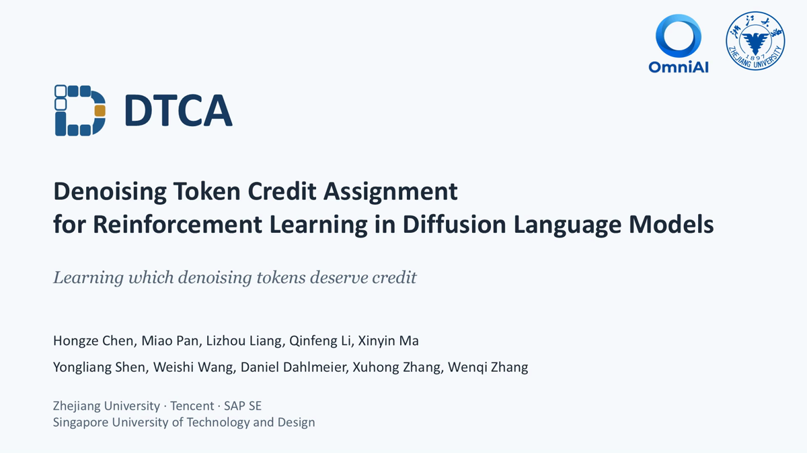

<div align="center">
  <p></p>
  <p>
    <a href="https://zju-omniai.github.io/DTCA/"></a>
    <a href="docs/assets/resources/dtca-paper.pdf"></a>
    <a href="pyproject.toml"></a>
    <a href="LICENSE"></a>
  </p>
</div>

## 📖 Overview

**DTCA** is a token-level credit assignment method for reinforcement learning
in diffusion language models. It combines contribution-weighted denoising
state selection, POS-based token credit assignment, and entropy-flow calibration.
This repository provides the main experiments on LLaDA-8B-Instruct.

## 🚀 Quick Start

### 1. Install

Use Linux, Python 3.10 or 3.11, and CUDA-compatible PyTorch. Run the following
commands from the repository root.

```bash
python -m pip install -e .
python -m spacy download en_core_web_sm
```

### 2. Prepare the model and data

```bash
hf download GSAI-ML/LLaDA-8B-Instruct \
  --local-dir models/LLaDA-8B-Instruct

python scripts/prepare_data.py
```

See [data/README.md](data/README.md) for dataset sources and uses.

### 3. Build the POS table

```bash
accelerate launch --num_processes 8 scripts/build_table.py \
  --config configs/dtca.yaml
```

The table is saved to `artifacts/pos.json`. Response records in
`artifacts/records` support resuming collection.

### 4. Train

```bash
accelerate launch --num_processes 8 scripts/train.py \
  --config configs/dtca.yaml
```

Training uses Accelerate and DeepSpeed ZeRO-3. Settings are defined in
[configs/dtca.yaml](configs/dtca.yaml). MATH500 evaluation runs before training
and every five updates, retaining the best checkpoint by accuracy.
The final model and tokenizer are saved to `runs/dtca/model/checkpoint-final`,
together with the POS table.

Use `--set KEY=VALUE` to override paths or settings:

```bash
accelerate launch --num_processes 8 scripts/train.py \
  --config configs/dtca.yaml \
  --set model.pretrained_model=/path/to/model \
        dtca.table=/path/to/pos.json \
        experiment.project=runs/custom
```

## 📊 Evaluation

Evaluate a trained checkpoint:

```bash
accelerate launch --num_processes 8 scripts/eval.py \
  --config configs/dtca.yaml \
  --checkpoint runs/dtca/model/checkpoint-final
```

Evaluate the base model:

```bash
accelerate launch --num_processes 8 scripts/eval.py \
  --config configs/dtca.yaml \
  --checkpoint models/LLaDA-8B-Instruct \
  --output runs/base/eval
```

Evaluation covers MATH500 and GSM8K test at 128, 256, and 512 tokens, with
temperature zero and one response per question. Results are saved as
`batch_eval_results.jsonl` and `batch_eval_summary.json` under
`runs/dtca/eval/` or the specified output directory.

## 🏗️ Repository Layout

```text
├── assets/             README cover
├── docs/               Project website
├── configs/dtca.yaml    Training and evaluation settings
├── accelerate_configs/ DeepSpeed configuration
├── dtca/               Contribution, POS, state selection, and credit
├── models/             LLaDA training model
├── rollout/            LLaDA decoding and rollout model
├── trainer/            Training and evaluation
├── reward/             Math scoring
├── scripts/            Data preparation, table construction, training, and evaluation
├── tests/              Numerical and integration tests
└── data/               Dataset instructions
```

## 🧪 Tests

```bash
python -m pip install -e '.[dev]'
python -m pytest
```

## 🙏 Acknowledgements

This implementation builds on official
[RLDF / Drift](https://github.com/ant-research/Drift/tree/787d875d7e992e92f883049cef58bcd49ef34844).
We also thank [dLLM-RL](https://github.com/Gen-Verse/dLLM-RL),
[Fast-dLLM](https://github.com/NVlabs/Fast-dLLM), and
[LLaDA](https://github.com/ML-GSAI/LLaDA). Entropy-flow calibration is inspired
by [OPEFO](https://arxiv.org/abs/2605.11491).

## 📝 Citation

If you use DTCA in your research, please cite:

```bibtex
@misc{chen2026dtca,
  title  = {{DTCA}: Denoising Token Credit Assignment for Reinforcement Learning in Diffusion Language Models},
  author = {Chen, Hongze and Pan, Miao and Liang, Lizhou and Li, Qinfeng and Ma, Xinyin and Shen, Yongliang and Wang, Weishi and Dahlmeier, Daniel and Zhang, Xuhong and Zhang, Wenqi},
  year   = {2026}
}
```

Please also cite the upstream RLDF work:

```bibtex
@article{he2026reinforcement,
  title={Reinforcement Learning from Denoising Feedback},
  author={He, Qi and Chen, Huan and Guo, Ya and Zhu, Huijia and Fung, Yi R and Zhou, Baojian},
  journal={arXiv preprint arXiv:2605.25638},
  year={2026}
}
```

## ⚖️ License

DTCA source code is released under the [Apache License 2.0](LICENSE).
Third-party models and datasets remain subject to their original licenses.
